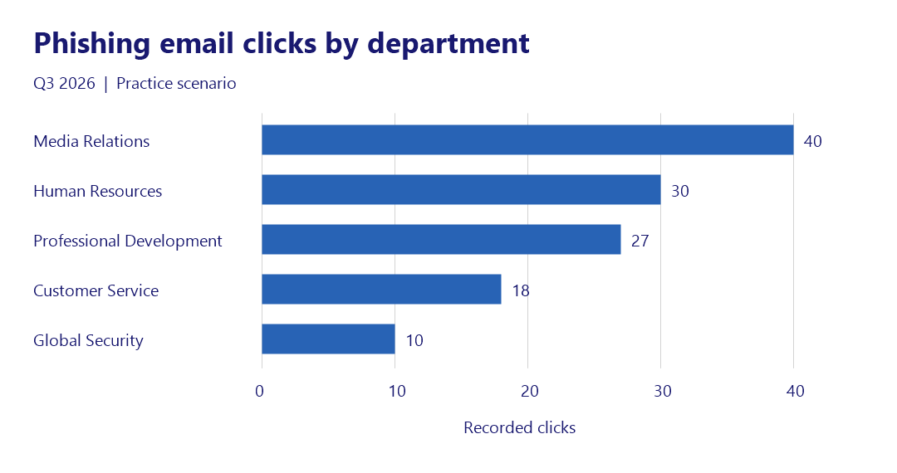

# Why visual dashboards matter in cybersecurity

I put this guide together from what I learned in the **Google Cybersecurity Professional Certificate on Coursera**. I wanted a quick reference I could come back to whenever I need to explain a security finding to someone who has to act on it.

A dashboard brings important data into one place so stakeholders can see what needs attention. A chart can show where activity is concentrated. The update around it should explain why it matters, what’s still unknown, and what you want the reader to do next.

## Know who needs the update

A **stakeholder** is a person or group with an interest in an organization’s activities or decisions. Several stakeholders can care about the same security issue and need different details.

| Stakeholder | What they might need from a security update |
| --- | --- |
| Risk manager | The risk, how the response is being managed, and whether legal or public relations needs to be involved. |
| CEO | The potential business impact, any disruption to operations, and decisions that need executive attention. |
| CFO | The costs of tools, training, and other response options when funding is needed. |
| CISO | What the evidence says about risk and security controls, what to prioritize, and any implications for business continuity. |
| Security operations manager | What analysts need to verify, who owns the follow-up, and what to track in day-to-day operations. |

## A simple phishing dashboard

In this practice scenario, the CISO asks security operations how many employees are clicking phishing emails and how often. The starter data shows **recorded phishing email clicks** for five departments in Q3 2026.

Media Relations had the highest recorded count among the five departments, with 40 clicks, followed by Human Resources with 30. That gives the security team a starting point for reviewing the underlying data. Counts alone leave two questions open: how many unique employees clicked, and how many employees in each department received the emails. One employee could account for multiple clicks. Differences in exposure could also affect the totals.

If the CISO wants a department-level comparison, I’d ask for the number of **unique recipients who clicked at least once** and the **number of unique recipients who received an email** in the same reporting period. Dividing the first by the second gives the share of exposed employees who clicked. If the question is how often individuals clicked, I’d also check for repeat clicks.

## Turn the chart into a stakeholder update

Build the update around the security challenge, its possible impact, and a practical response. Include the finding that supports the action, keep the purpose clear, and use technical terms only where they help the reader.

> In Q3, Media Relations recorded 40 phishing email clicks, the most among the five departments shown. Phishing clicks can expose employees to credential theft. Security Operations should verify how many people received and clicked the emails before we use the findings to prioritize training. Once we have the numbers, we can agree on a follow-up and measure it in the next reporting period.

The CISO could use a short email with the chart and the decision needed. An operations manager could use a ticket to assign the data review and track its due date. A longer document can capture the methodology and supporting findings when the audience needs that detail.

## How this scales in the field

This is a deliberately basic graph and scenario. Depending on your role, a real dashboard might combine several charts and tables. An analyst might need campaign filters and event details to verify repeat activity. An operations manager might track open actions and owners. A CISO might want a trend over several quarters, click and report rates, and a summary of what needs a decision.

When building your own dashboard, start with the stakeholder’s question, choose a metric that answers it, label the time period and units, and leave the reader with a clear next step.

